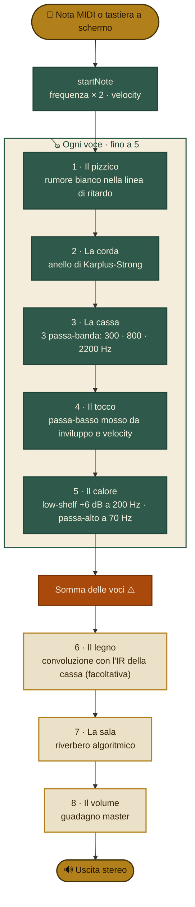
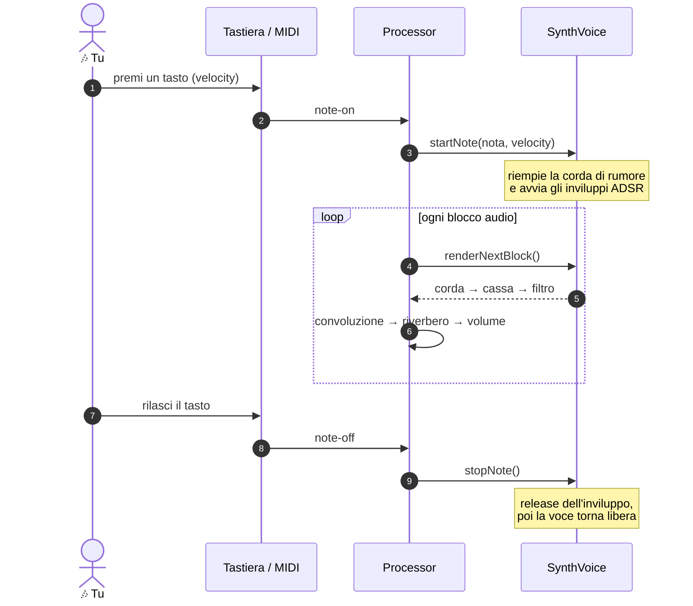
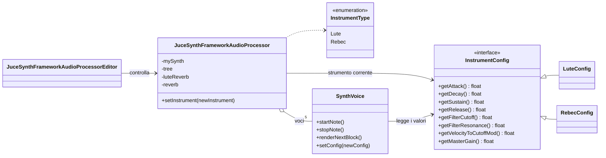
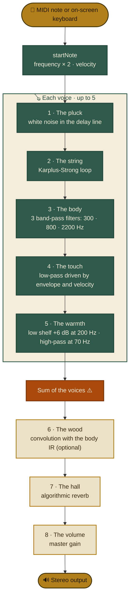
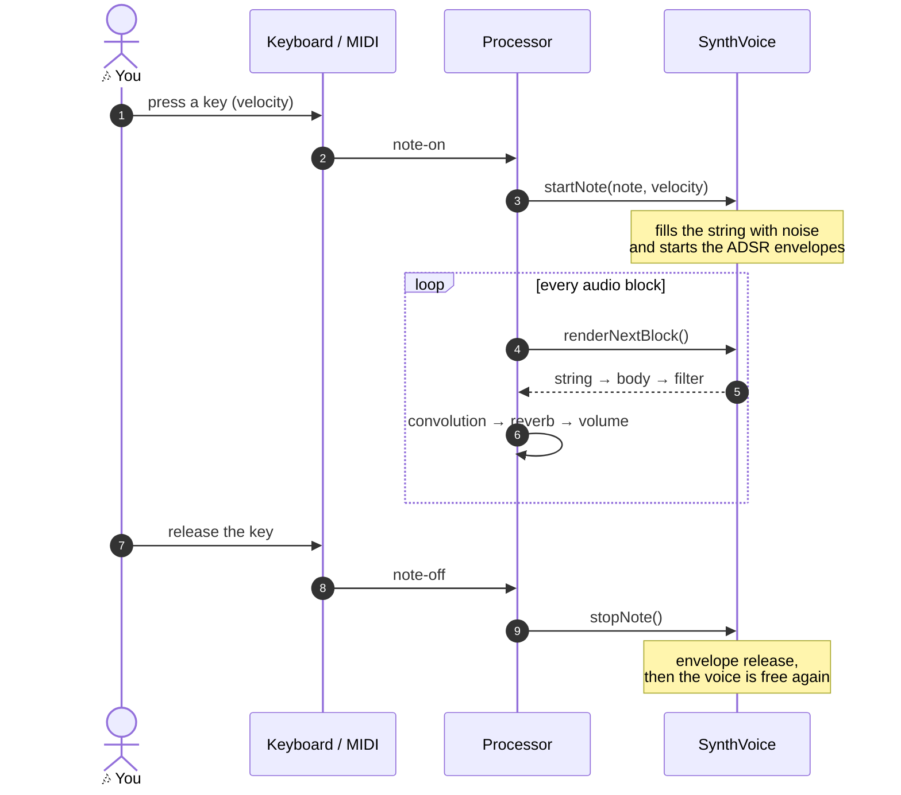
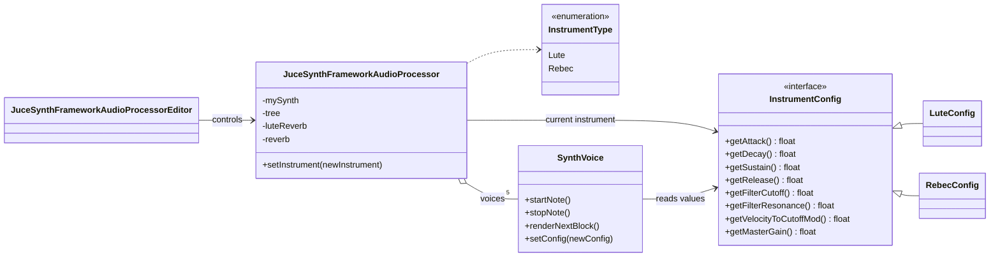

<a id="top"></a>

<div align="center">


<p><b>Sintetizzatore a modelli fisici per strumenti medievali</b><br>
<i>Physical-modelling synthesizer for medieval instruments</i></p>

[](https://juce.com/)
[](https://en.wikipedia.org/wiki/Karplus%E2%80%93Strong_string_synthesis)


[](https://github.com/tommasomilleri/MedSynth_SoundDesign/raw/main/Joglar.exe)


<p><b>Scegli la tua lingua, viandante</b> · <i>Choose your tongue, traveller</i></p>

<a href="#italiano"></a>
<a href="#english"></a>

</div>

<a id="italiano"></a>

# 🇮🇹 Italiano

## 🕯️ Prologo

<p align="center">
  
</p>

**Joglar** (in occitano antico *joglar*, dal latino *ioculator*: il giullare, il musico girovago di corti e fiere) è un sintetizzatore software scritto in **C++** con il framework **JUCE**. Non suona campioni registrati: **calcola** ogni nota, campione dopo campione, simulando una corda pizzicata che vibra dentro una cassa di legno. Nella bisaccia ci sono oggi due strumenti, il **liuto** e la **ribeca**.

Nato come progetto universitario di audio development e sound design all'Università Politecnica delle Marche (UNIVPM), è pensato per compositori e sound designer che lavorano su videogiochi, film e media interattivi di ambientazione storica.

> [!NOTE]
> **Stato del progetto: in cantiere.** Il motore a corda pizzicata, le risonanze della cassa, il riverbero e l'interfaccia funzionano. Alcune parti (somma delle voci, volume senza click, chorus, oscillatori, pitch bend) sono scritte ma non ancora collegate, oppure vanno corrette: il quadro completo, con i rimedi, è nel [Cantiere](#-il-cantiere-della-cattedrale).

<p align="center"></p>

## 🧭 Scegli il tuo sentiero

| Se sei… | …imbocca questa via |
|---|---|
| 🎶 **Menestrello**: vuoi solo suonare | [Suonare in tre mosse](#-suonare-in-tre-mosse) · [Le prove del menestrello](#-le-prove-del-menestrello) |
| 🪵 **Liutaio**: vuoi capire come nasce il suono | [La bottega del liutaio](#-la-bottega-del-liutaio) |
| 🏛️ **Architetto**: vuoi leggere il progetto | [L'architettura del castello](#-larchitettura-del-castello) · [Il pannello dei parametri](#-il-pannello-dei-parametri) |
| ⚒️ **Fabbro**: vuoi compilare dal sorgente | [La fucina](#-la-fucina-compilare-dal-sorgente) |
| 📜 **Amanuense**: vuoi aggiungere uno strumento | [Forgiare un nuovo strumento](#-forgiare-un-nuovo-strumento) |
| 🗺️ **Cartografo**: vuoi orientarti nel codice | [La mappa del feudo](#-la-mappa-del-feudo) |
| 🛡️ **Cavaliere**: vuoi dare una mano | [Il cantiere](#-il-cantiere-della-cattedrale) · [Unisciti alla compagnia](#-unisciti-alla-compagnia) |

<p align="center"></p>

## 📋 Scheda tecnica

| Voce | Dettaglio |
|---|---|
| 🏷️ **Nome** | Joglar · versione 1.0.0 |
| 🎹 **Tipo** | Strumento virtuale (synth): ingresso MIDI, uscita audio stereo, nessuna uscita MIDI |
| 📦 **Formati** | VST3 · AU (solo macOS) · Standalone |
| 🧰 **Build** | Projucer → Visual Studio 2022 · Xcode |
| 🧪 **Sintesi** | Karplus-Strong · formanti della cassa · filtro dinamico · convoluzione · riverbero |
| 🎼 **Voci** | 5, con *note stealing* (la somma delle voci va ancora corretta: vedi il [Bestiario](#-il-bestiario-dei-difetti-noti)) |
| 🪕 **Strumenti** | Liuto · Ribeca |
| 🖼️ **Interfaccia** | 427 × 640 px, non ridimensionabile · selettore dello strumento · tastiera MIDI a schermo (note 0–127) · font *Cinzel Decorative* |
| 🔑 **Identificativi** | Plugin `JGLR` · Costruttore `MILL` |
| 🪟 **Eseguibile** | [`Joglar.exe`](https://github.com/tommasomilleri/MedSynth_SoundDesign/raw/main/Joglar.exe) · Standalone per Windows x64 · circa 17 MB · compilato con JUCE 8.0.7 |
| 📚 **Documentazione** | [`Documentazione.html`](./Documentazione.html), il manuale tecnico in italiano (scaricalo e aprilo nel browser) |

<p align="center"></p>

## 🎶 Suonare in tre mosse

1. **Windows, senza compilare nulla:** scarica [`Joglar.exe`](https://github.com/tommasomilleri/MedSynth_SoundDesign/raw/main/Joglar.exe) e avvialo.
2. Dal menu in alto scegli **Lute** o **Rebec**: l'immagine dello strumento cambia insieme al timbro. All'avvio il menu appare vuoto, ma il liuto è già pronto.
3. Suona con la **tastiera a schermo**, con una tastiera MIDI oppure con la tastiera del computer.

> [!NOTE]
> **Primo avvio su Windows.** L'eseguibile non è firmato, quindi SmartScreen può mostrare «Windows ha protetto il PC»: scegli *Ulteriori informazioni → Esegui comunque*. Se compare un errore su `VCRUNTIME140.dll` o `MSVCP140.dll`, installa il [Microsoft Visual C++ Redistributable (x64)](https://learn.microsoft.com/cpp/windows/latest-supported-vc-redist).

> [!TIP]
> **La tastiera del computer.** Nella versione Standalone, dopo un clic sulla tastiera a schermo, la fila centrale (**A S D F G H J K L**) suona i tasti bianchi e quella superiore (**W E T Y U O P**) i neri, a partire dalla nota MIDI 72.

> [!IMPORTANT]
> **Attenzione all'ottava.** Joglar suona **un'ottava sopra** la nota MIDI ricevuta: la nota MIDI 60 (il Do centrale, che la tastiera di JUCE etichetta «C3») suona come la nota MIDI 72. Tienine conto quando scrivi una partitura.

### 🏆 Le prove del menestrello

Quattro piccole imprese per conoscere Joglar con l'orecchio.

| Prova | Come | Cosa senti |
|---|---|---|
| **I · Il tocco** | Suona la stessa nota due volte, cliccando prima vicino alla cima del tasto e poi vicino al fondo: sulla tastiera a schermo la velocity cresce verso il basso. | La seconda nota è più forte e più brillante, come una corda pizzicata con più decisione: la velocity apre anche il filtro. |
| **II · Il cambio di liuteria** | Passa da *Lute* a *Rebec* e rigioca la stessa frase. | Il filtro di base salta da 900 a 4500 Hz e il carattere cambia: da intimo e scuro a nasale e luminoso. |
| **III · L'accordo** | Premi tre tasti insieme, con una tastiera MIDI o con quella del computer. | Dovresti sentire tre note. Se ne senti una sola, hai incontrato l'Idra delle Voci ([Bestiario](#-il-bestiario-dei-difetti-noti)). |
| **IV · Il tuo legno** | Crea una cartella `IR` accanto all'eseguibile, mettici una breve risposta all'impulso chiamata `lute_ir.wav` e riavvia. | La cassa prende il colore della tua IR: ne vengono usati i primi 2048 campioni, circa 46 ms. |

<p align="center"></p>

## 🪕 Gli strumenti nella bisaccia

<table align="center">
  <tr>
    <th align="center">🪕 Liuto</th>
    <th align="center">🎻 Ribeca</th>
  </tr>
  <tr>
    <td align="center"></td>
    <td align="center"></td>
  </tr>
  <tr>
    <td valign="top">Discendente dell'<i>ʿūd</i> arabo, giunto in Europa attraverso la Spagna e la Sicilia. Nel Medioevo si suonava con un plettro ricavato da una penna: un suono intimo, rotondo, che si spegne in fretta.<br><br><code>LuteConfig.h</code></td>
    <td valign="top">Parente del <i>rabāb</i>, tradizionalmente suonata ad arco, con la cassa a pera scavata in un unico blocco di legno e di norma tre corde. Voce nasale e penetrante, fatta per sentirsi sopra il chiasso di una festa.<br><br><code>RebecConfig.h</code></td>
  </tr>
</table>

Come li imita Joglar, in un colpo d'occhio (scala indicativa):

| Carattere | 🪕 Liuto | 🎻 Ribeca |
|---|---|---|
| Brillantezza (cutoff) | `██░░░░░░░░` 900 Hz | `█████████░` 4500 Hz |
| Sensibilità al tocco | `█░░░░░░░░░` +80 Hz | `██████████` +1200 Hz |
| Guadagno della voce | `██████████` 3.0 | `███░░░░░░░` 0.75 |

<details>
<summary><b>📊 I valori esatti del sorgente</b> · <i>clicca per aprire lo scrigno</i></summary>

<br>

| Parametro | 🪕 Liuto | 🎻 Ribeca |
|---|---|---|
| Attack | 30 | 0.04 ⁎ |
| Decay | 600 | 0.2 ⁎ |
| Sustain | 1.2 ⁎ | 0.8 |
| Release | 180 | 0.5 ⁎ |
| Cutoff del filtro | 900 Hz | 4500 Hz |
| Risonanza | 0.10 | 0.30 |
| Velocity → cutoff | 80 Hz | 1200 Hz |
| Guadagno della voce | 3.0 | 0.75 |
| Pitch bend (su / giù) | 1 / 1 | 2 / 2 |

La voce legge attack, decay e release come **millisecondi** (li divide per 1000); il sustain è un livello fra 0 e 1.

⁎ Valori fuori scala: vedi il Lupo dell'Inviluppo nel [Bestiario](#-il-bestiario-dei-difetti-noti).

</details>

<p align="center"></p>

## 🪵 La bottega del liutaio

Nessun campione, nessuna registrazione: ogni nota nasce da zero. Ecco il viaggio del suono, dal dito all'orecchio.



> [!WARNING]
> Il nodo ⚠️ indica che la somma delle voci va ancora corretta: oggi ogni voce sovrascrive il buffer invece di sommarsi (l'**Idra delle Voci** nel [Bestiario](#-il-bestiario-dei-difetti-noti)).

<details>
<summary><b>1 · Il pizzico</b></summary>

<br>

Quando arriva una nota, la voce calcola la lunghezza della «corda» (una linea di ritardo lunga `sampleRate / frequenza` campioni) e la riempie di **rumore bianco**: è l'energia caotica del plettro che colpisce la corda. A questo si somma un brevissimo soffio di rumore di **5 ms** che imita l'attacco. La frequenza è quella della nota MIDI **raddoppiata**: da qui l'ottava in più.

</details>

<details>
<summary><b>2 · La corda</b></summary>

<br>

È l'algoritmo di **Karplus-Strong**: il rumore gira in cerchio nella linea di ritardo e a ogni giro viene mediato con il campione precedente (un passa-basso elementare) e attenuato. Il rumore si «ordina» da solo in una nota intonata che si spegne in modo naturale, con gli acuti che muoiono prima dei gravi, come su una corda vera. Le note che suonano sotto i 250 Hz (fino alla nota MIDI 47) sono attenuate di **0.970** per giro, le altre di **0.965**.

</details>

<details>
<summary><b>3 · La cassa</b></summary>

<br>

Una corda senza cassa è un filo che ronza. Tre filtri passa-banda fissi a **300, 800 e 2200 Hz** simulano le risonanze (formanti) del corpo di legno e vengono miscelati al segnale della corda: di più sulle note gravi (50%), di meno sulle acute (35%).

</details>

<details>
<summary><b>4 · Il tocco</b></summary>

<br>

Un passa-basso dinamico modella la brillantezza nel tempo. La sua frequenza di taglio è:

```
cutoff = base + inviluppo × base + velocity × modulazione
```

All'attacco il filtro è aperto e il suono brilla; poi si richiude e il timbro si scurisce mentre la nota si spegne. Un low-shelf a 200 Hz (+6 dB) aggiunge corpo e un passa-alto a 70 Hz ripulisce il fondo.

</details>

<details>
<summary><b>5 · Il legno, la sala e il volume</b></summary>

<br>

Il segnale attraversa due ambienti e infine il volume master:

- **Convoluzione** con una risposta all'impulso: se accanto all'eseguibile esiste `IR/lute_ir.wav`, la risposta viene caricata e **troncata a 2048 campioni** (circa 46 ms a 44,1 kHz). È pensata per la risonanza della cassa, non per una sala. Il file **non è incluso** nel repository: è facoltativo, e senza IR la convoluzione lascia passare il segnale invariato.
- **Riverbero** algoritmico (`juce::Reverb`) per collocare lo strumento in una sala. Le voci sono mono: la spazialità nasce qui.
- **Volume master** (`masterGain`) applicato all'uscita. Lo smoothing previsto per evitare i click non è ancora attivo: è il Grillo del Volume nel [Bestiario](#-il-bestiario-dei-difetti-noti).

</details>

Il ciclo di vita di una nota, passo per passo:



<p align="center"></p>

## 🏰 L'architettura del castello



- **Strategy pattern.** Ogni strumento è una classe che eredita da `InstrumentConfig`. La voce non sa quale strumento sta suonando: chiede i valori alla configurazione corrente, e `setInstrument()` la sostituisce al volo (oggi senza protezione dal thread audio: vedi lo Scorpione del Cambio nel [Bestiario](#-il-bestiario-dei-difetti-noti)).
- **Il modello dei parametri.** `AudioProcessorValueTreeState` è il centro dei parametri, visibili all'host per l'automazione; separa la logica audio dalla GUI.
- **Voci e polifonia.** Un `juce::Synthesiser` gestisce 5 `SynthVoice` con *note stealing*: all'arrivo di una sesta nota viene riassegnata una voce già in uso.
- **L'editor.** L'interfaccia è volutamente essenziale: selettore dello strumento, immagine, tastiera. Lo stile (`CarnivalLookAndFeel`) usa i colori della pergamena.

<p align="center"></p>

## 🔧 Il pannello dei parametri

Il processore registra 18 parametri, ma solo alcuni incidono oggi sul suono.

<details>
<summary><b>Vedi la tabella dei parametri</b></summary>

<br>

**Legenda:** 🟢 influenza il suono · 🟡 letto, ma il risultato non è applicato all'audio · ⚪ solo registrato.

| ID | Intervallo | Predefinito | Stato |
|---|---|---|---|
| `masterGain` | 0 – 1 | 0.7 | 🟢 |
| `reverbRoom` | 0.5 – 0.8 | 0.1 ⁎ | 🟢 |
| `reverbDamp` | 0.5 – 0.8 | 0.5 | 🟢 |
| `filterType` | 0 – 2 | 0 | 🟡 |
| `filterCutoff` | 20 – 10000 | 400 | 🟡 |
| `filterRes` | 1 – 5 | 1 | 🟡 |
| `attack` | 0.1 – 5000 | 0.1 | ⚪ |
| `decay` | 1 – 2000 | 1 | ⚪ |
| `sustain` | 0 – 1 | 0.8 | ⚪ |
| `release` | 0.1 – 5000 | 0.1 | ⚪ |
| `wavetype` | 0 – 2 | 0 | ⚪ |
| `wavetype2` | 0 – 2 | 0 | ⚪ |
| `blend` | 0 – 1 | 0.6 | ⚪ |
| `pbup` | 1 – 12 | 2 | ⚪ |
| `pbdown` | 1 – 12 | 2 | ⚪ |
| `chorusRate` | 0 – 0 | 0 | ⚪ |
| `chorusDepth` | 0 – 0 | 0 | ⚪ |
| `smoothingSamples` | 1 – 1000 | 100 | ⚪ |

⁎ Il valore predefinito è fuori dall'intervallo dichiarato.

Inviluppo, forme d'onda e pitch bend vengono oggi dalla configurazione dello strumento, non da questi parametri.

</details>

<p align="center"></p>

## 🔨 La fucina: compilare dal sorgente

**Occorrente:** [JUCE](https://juce.com/) 6 o successivo, con l'applicazione Projucer (l'eseguibile incluso è stato compilato con JUCE 8.0.7), e un compilatore C++: Visual Studio 2022 su Windows, Xcode su macOS.

```bash
git clone https://github.com/tommasomilleri/MedSynth_SoundDesign.git
```

1. Apri `Joglar.jucer` con **Projucer**.
2. In *File → Global Paths…* (su macOS *Projucer → Global Paths…*) indica la cartella di JUCE e quella dei moduli: il progetto usa i percorsi globali di Projucer, non percorsi relativi.
3. Scegli l'exporter (**Visual Studio 2022** o **Xcode**) e premi *Save Project and Open in IDE*.
4. Compila il target che ti serve:

| Obiettivo | Target | Piattaforma |
|---|---|---|
| Provarlo subito | **Standalone** | Windows · macOS |
| Usarlo in una DAW | **VST3** | Windows · macOS |
| Usarlo in Logic e simili | **AU** | solo macOS |

> [!NOTE]
> Nel file `.jucer` c'è anche un exporter **Visual Studio 2017**, ma Projucer lo ha rimosso a partire da JUCE 8.0.1: usa Visual Studio 2022. Con JUCE 8 i costruttori di `juce::Font` usati nell'interfaccia sono deprecati e producono avvisi, non errori. Il percorso di inclusione `Source/Maximilian/libs` indicato nel progetto non esiste e si può togliere.

<p align="center"></p>

## 📜 Forgiare un nuovo strumento

Aggiungere uno strumento significa descrivere il suo carattere. Ecco un salterio, a titolo d'esempio.

**1.** Aggiungi la voce all'elenco in `InstrumentType.h`:

```cpp
enum class InstrumentType { Lute = 1, Rebec = 2, Psaltery = 3 };
```

**2.** Crea `PsalteryConfig.h`:

```cpp
#pragma once
#include "InstrumentConfig.h"

class PsalteryConfig : public InstrumentConfig {
  public:
    float getAttack() const override { return 5.0f; }     // millisecondi
    float getDecay() const override { return 900.0f; }    // millisecondi
    float getSustain() const override { return 0.6f; }    // livello, da 0 a 1
    float getRelease() const override { return 400.0f; }  // millisecondi
    int getOsc1Waveform() const override { return 1; }
    int getOsc2Waveform() const override { return 1; }
    float getFilterCutoff() const override { return 6000.0f; }
    float getFilterResonance() const override { return 0.20f; }
    float getPitchBendUp() const override { return 1.0f; }
    float getPitchBendDown() const override { return 1.0f; }
    float getVelocityToCutoffMod() const override { return 600.0f; }
    float getMasterGain() const override { return 1.0f; }
};
```

**3.** In `PluginProcessor.cpp` includi `PsalteryConfig.h` e aggiungi il ramo in `setInstrument()`, prima dell'`else`:

```cpp
else if (newInstrument == InstrumentType::Psaltery)
    currentConfig = std::make_unique<PsalteryConfig>();
```

**4.** In `PluginEditor.cpp` aggiungi la voce al menu (con lo stesso numero dell'enum) e la sua immagine, dopo averla aggiunta alle risorse del progetto in Projucer:

```cpp
instrumentSelector.addItem("Psaltery", static_cast<int>(InstrumentType::Psaltery));
imagesMap[InstrumentType::Psaltery] = juce::ImageFileFormat::loadFrom(
    BinaryData::psaltery_png, BinaryData::psaltery_pngSize);
```

> [!NOTE]
> Oggi la corda di Karplus-Strong è la stessa per tutti gli strumenti: ciò che li distingue è l'inviluppo, il filtro e il guadagno. Le forme d'onda dichiarate nelle configurazioni non vengono ancora usate dalla voce.

<p align="center"></p>

## 🌍 La mappa del feudo

```
MedSynth_SoundDesign/
├── README.md                   questa pagina
├── assets/readme/              cornici, divisori e ritratti di questa pagina
├── Joglar.jucer                il progetto Projucer
├── Joglar.exe                  standalone per Windows x64, già compilato
├── Documentazione.html         il manuale tecnico (in italiano)
└── Source/
    ├── PluginProcessor.*       il castello: MIDI, voci, effetti, parametri
    ├── SynthVoice.*            la bottega: corda, cassa, tocco
    ├── SynthSound.h            il suono che le voci sanno eseguire
    ├── InstrumentConfig.h      il contratto che ogni strumento rispetta
    ├── LuteConfig.h            il carattere del liuto
    ├── RebecConfig.h           il carattere della ribeca
    ├── InstrumentType.h        l'elenco degli strumenti
    ├── PluginEditor.*          la sala: sfondo, menu, tastiera, immagine
    ├── CarnivalLookAndFeel.*   i colori di pergamena e il font
    ├── BannerComponent.*       lo stendardo decorativo (non ancora mostrato)
    ├── Oscillator*.*  Filter.* pannelli di controllo (non ancora mostrati)
    ├── SynthWrapperProcessor.h adattatore di servizio (non ancora usato)
    ├── .clang-format           lo stile del codice
    └── *.png  *.jpg            sfondi e ritratti degli strumenti
```

<p align="center"></p>

## 🧱 Il cantiere della cattedrale

Le cattedrali non si finiscono in una generazione. Ecco cosa sta in piedi e cosa attende i prossimi scalpellini.

**✅ Già costruito**

- [x] Sintesi a modelli fisici Karplus-Strong con linea di ritardo e rumore di pizzico
- [x] Risonanze della cassa e filtro dinamico sensibile al tocco
- [x] Convoluzione con IR esterna facoltativa e riverbero
- [x] Due strumenti selezionabili, interfaccia a tema, tastiera a schermo
- [x] Formati VST3, AU e Standalone, con eseguibile Windows precompilato

**🧱 Pietre già tagliate, ancora da posare**

- [ ] Somma corretta delle voci, per una vera polifonia
- [ ] Volume master con uno smoothing che funzioni davvero
- [ ] Chorus, oversampling, low-shelf e filtro SVF del processore: preparati, non ancora inseriti nella catena audio
- [ ] Pannelli `Oscillator`, `Oscillator2` e `Filter`, e i due oscillatori previsti dalle configurazioni
- [ ] Pitch bend
- [ ] Salvataggio e richiamo dello stato nella DAW
- [ ] Valori dell'inviluppo nelle unità giuste

**🔭 Visione**

- [ ] Un vero modello ad arco per la ribeca, che oggi condivide la corda pizzicata del liuto
- [ ] Nuovi strumenti: salterio, arpa, ghironda
- [ ] `IR/lute_ir.wav` distribuito insieme al progetto
- [ ] Preset, un'interfaccia con manopole per i parametri e uno screenshot nel README
- [ ] Versione di JUCE dichiarata, build con CMake e compilazione automatica su GitHub Actions
- [ ] Risorse grafiche del plugin alleggerite (oggi circa 9,8 MB incorporati nel binario, tra cui `sfondo.png` da 3,2 MB che non viene mostrato) e di provenienza documentata

### 📖 Il Bestiario dei difetti noti

<details>
<summary><b>Apri il Bestiario</b> · <i>qui si nascondono i draghi</i></summary>

<br>

Ogni creatura ha il suo rimedio: sono ottimi **primi incarichi** per chi vuole contribuire.

| Creatura | Sintomo | Dove | Rimedio |
|---|---|---|---|
| 🐉 **L'Idra delle Voci** | Negli accordi si sente una nota sola: ogni voce *sovrascrive* il buffer invece di sommarsi | `SynthVoice.cpp` (`outL[i] = out`) | usare `+=` su entrambi i canali |
| 🦇 **Il Pipistrello del Blocco** | Piccola discontinuità a ogni blocco audio: lo stato del filtro della corda riparte da zero | `SynthVoice.cpp` (`lpState`) | renderlo membro della voce, azzerato in `startNote()` |
| 🐺 **Il Lupo dell'Inviluppo** | La ribeca si spegne di colpo: 0.04 / 0.2 / 0.5 sono letti come millisecondi (attack 40 µs, release 0,5 ms). Nel liuto il sustain 1.2 supera il massimo: dopo l'attacco l'inviluppo salta a 1.2 e il decay di 600 ms non si sente | `RebecConfig.h`, `LuteConfig.h` | ribeca 40 / 200 / 500; sustain del liuto fra 0 e 1 |
| 🦗 **Il Grillo del Volume** | I cambi di `masterGain` possono fare click: lo smoothing non viene mai inizializzato, quindi salta subito al nuovo valore, e viene letto una sola volta per blocco | `PluginProcessor.h` / `.cpp` (`masterGainSmoothed`) | `SmoothedValue` lineare, `reset(sampleRate, 0.05)` in `prepareToPlay()` e rampa sul blocco (`applyGainRamp`) |
| 👻 **Lo Spettro del Menu** | All'avvio il menu degli strumenti è vuoto, anche se il liuto è già attivo | `PluginEditor.cpp` | `instrumentSelector.setSelectedId((int) processor.getCurrentInstrument(), juce::dontSendNotification)` |
| 🦂 **Lo Scorpione del Cambio** | Cambiando strumento mentre suona, una voce può leggere una configurazione appena distrutta: l'interfaccia la sostituisce mentre il thread audio la usa | `PluginProcessor.cpp` (`setInstrument`) | creare le due configurazioni una volta sola e scambiare un `std::atomic<InstrumentConfig*>` |
| 🦅 **Il Grifone Muto** | La ruota del pitch bend non fa nulla | `SynthVoice.h` (`pitchWheelMoved` vuoto) | implementarla con `getPitchBendUp/Down` |
| 🐍 **Il Basilisco della Memoria** | Lo strumento scelto non viene salvato con il progetto della DAW | `PluginProcessor.cpp` (`get/setStateInformation`) | serializzare il `ValueTree` e lo strumento |
| 🐀 **Il Ratto Allocatore** | CPU alta: i coefficienti del filtro si ricalcolano, con allocazione, a ogni campione e per ogni voce | `SynthVoice.cpp` (`makeLowPass`) | aggiornarli una volta per blocco |
| 🎤 **Il Cantore Stonato** | Intonazione approssimata sulle note acute: la corda ha una lunghezza intera in campioni | `SynthVoice.cpp` (`delaySamples`) | ritardo frazionario con interpolazione |
| 🕳️ **Il Cavaliere Solitario** | Con un bus mono il riverbero legge un secondo canale che non esiste | `PluginProcessor.cpp` (`processStereo`) | gestire il caso mono |
| 🏚️ **I Pannelli Dormienti** | `Oscillator`, `Oscillator2` e `Filter` non sono mostrati; in `Oscillator2` e `Filter` un `"paramID"` rimasto davanti al nome si concatena all'ID (`"paramID" "wavetype2"` diventa `paramIDwavetype2`) | `Oscillator2.cpp`, `Filter.cpp` | togliere il `"paramID"` superfluo e collegare i pannelli all'editor |

</details>

<p align="center"></p>

## ❓ Domande dal viandante

<details>
<summary><b>Nella versione Standalone non sento nulla.</b></summary>

<br>

Apri *Options → Audio/MIDI Settings* nella finestra Standalone, controlla il dispositivo di uscita e il volume e, se usi una tastiera MIDI, attiva il suo ingresso. Poi clicca un tasto sulla tastiera a schermo: il liuto è già attivo anche se il menu appare vuoto.

</details>

<details>
<summary><b>Perché suona un'ottava più in alto?</b></summary>

<br>

È voluto: in `startNote()` la voce raddoppia la frequenza della nota MIDI (il commento dice «un'ottava sopra»). Per ottenere l'altezza che hai in mente, suona un'ottava sotto.

</details>

<details>
<summary><b>Negli accordi si sente una nota sola.</b></summary>

<br>

È l'Idra delle Voci, il primo difetto del [Bestiario](#-il-bestiario-dei-difetti-noti). Si risolve con una riga di codice.

</details>

<details>
<summary><b>L'IR non viene caricata.</b></summary>

<br>

Il file deve chiamarsi `lute_ir.wav` e stare in una cartella `IR` accanto all'eseguibile. Per i plugin conta il binario dentro il bundle: per esempio `Joglar.vst3/Contents/x86_64-win/IR/` su Windows o `Contents/MacOS/IR/` su macOS. Il file viene letto all'avvio dell'audio, quindi riavvia l'applicazione. Se manca, il messaggio compare solo nelle build di debug.

</details>

<details>
<summary><b>Il font del menu è diverso dalle immagini.</b></summary>

<br>

Il menu usa *Cinzel Decorative*. Se non è installato viene usato un carattere predefinito: scaricalo da [Google Fonts](https://fonts.google.com/specimen/Cinzel+Decorative).

</details>

<details>
<summary><b><code>Documentazione.html</code> si apre come codice.</b></summary>

<br>

GitHub mostra i file HTML come sorgente. Apri il file, scegli *Download raw file* e aprilo nel browser.

</details>

<details>
<summary><b>Posso usarlo su macOS o Linux?</b></summary>

<br>

L'eseguibile precompilato è solo per Windows x64. Su macOS puoi compilare Standalone, VST3 e AU con Xcode. Per Linux il progetto non ha un exporter configurato.

</details>

<details>
<summary><b>Posso usarlo nel mio videogioco o nel mio film?</b></summary>

<br>

Il repository non dichiara ancora una licenza: finché non ne verrà aggiunta una, i diritti restano riservati all'autore. Scrivi un'issue per chiedere.

</details>

<p align="center"></p>

## 📚 Il glossario e la biblioteca

| Nella bottega medievale | Nella bottega digitale |
|---|---|
| Il plettro che colpisce | Un'esplosione di rumore bianco |
| La corda che vibra | Una linea di ritardo con retroazione |
| La cassa di legno | Filtri passa-banda e convoluzione |
| La forza della mano | La velocity MIDI |
| La sala del castello | Il riverbero |
| Il liutaio | `InstrumentConfig` |
| Il joglar | Tu |

**Per approfondire**

- K. Karplus, A. Strong, *Digital Synthesis of Plucked-String and Drum Timbres*, Computer Music Journal, 1983: l'algoritmo da cui nasce la corda di Joglar.
- D. A. Jaffe, J. O. Smith, *Extensions of the Karplus-Strong Plucked-String Algorithm*, Computer Music Journal, 1983.
- J. O. Smith III, *Physical Audio Signal Processing*, CCRMA, Stanford University: [ccrma.stanford.edu/~jos/pasp](https://ccrma.stanford.edu/~jos/pasp/).
- [JUCE](https://juce.com/): documentazione e tutorial del framework.
- [`Documentazione.html`](./Documentazione.html): l'analisi file per file di questo progetto.

<p align="center"></p>

## 🤝 Unisciti alla compagnia

1. Fai un **fork** e crea un ramo per la tua impresa.
2. Rispetta lo stile del codice: in `Source/` trovi un `.clang-format`.
3. Apri una **pull request** descrivendo cosa cambia e come l'hai provato, all'orecchio e nel codice.

Non sai da dove cominciare? Scegli una creatura del [Bestiario](#-il-bestiario-dei-difetti-noti) o aggiungi un nuovo strumento con la [guida](#-forgiare-un-nuovo-strumento).

<p align="center"></p>

## ⚖️ Licenza e crediti

- **Licenza:** il repository non dichiara ancora una licenza. Finché non ne verrà aggiunta una, i diritti restano riservati all'autore.
- **JUCE:** JUCE 8 è distribuito con doppia licenza, [AGPLv3 o commerciale](https://github.com/juce-framework/JUCE/blob/master/LICENSE.md): chi distribuisce una build deve rispettarne una delle due.
- **Immagini:** sfondi e ritratti degli strumenti sono in `Source/`; la loro provenienza non è ancora documentata. Le decorazioni di questa pagina (`assets/readme/`) sono ricavate dalla cornice dell'interfaccia e da quei ritratti; i testi sono composti in Cinzel Decorative, Cinzel ed EB Garamond (SIL Open Font License) e convertiti in tracciati.
- **Autore:** **Tommaso Milleri** · progetto di audio development e sound design, Università Politecnica delle Marche (UNIVPM).

<p align="center">
  
</p>

<div align="center">

[⬆ Torna alle porte](#top) &nbsp;·&nbsp; [🇬🇧 Read it in English](#english)

</div>

<p align="center"></p>

<a id="english"></a>

# 🇬🇧 English

## 🕯️ Prologue

<p align="center">
  
</p>

**Joglar** (Old Occitan *joglar*, from Latin *ioculator*: the jongleur, the wandering musician of courts and fairs) is a software synthesizer written in **C++** with the **JUCE** framework. It plays no recorded samples: it **computes** every note, sample by sample, by simulating a plucked string vibrating inside a wooden body. The satchel currently holds two instruments, the **lute** and the **rebec**.

It began as a university audio development and sound design project at the Università Politecnica delle Marche (UNIVPM) and is meant for composers and sound designers scoring games, films and interactive media with a historical setting.

> [!NOTE]
> **Project status: work in progress.** The plucked-string engine, the body resonances, the reverb and the interface all work. A few parts (voice summing, click-free volume, chorus, oscillators, pitch bend) are written but not yet wired in, or still need fixing: the full picture, with remedies, is in the [Building Site](#-the-cathedral-building-site).

<p align="center"></p>

## 🧭 Choose your path

| If you are a… | …take this road |
|---|---|
| 🎶 **Minstrel**: you just want to play | [Play in three moves](#-play-in-three-moves) · [The minstrel's trials](#-the-minstrels-trials) |
| 🪵 **Luthier**: you want to know how the sound is born | [The luthier's workshop](#-the-luthiers-workshop) |
| 🏛️ **Architect**: you want to read the design | [The castle's architecture](#-the-castles-architecture) · [The parameter panel](#-the-parameter-panel) |
| ⚒️ **Blacksmith**: you want to build from source | [The forge](#-the-forge-building-from-source) |
| 📜 **Scribe**: you want to add an instrument | [Forging a new instrument](#-forging-a-new-instrument) |
| 🗺️ **Cartographer**: you want to find your way in the code | [The map of the realm](#-the-map-of-the-realm) |
| 🛡️ **Knight**: you want to lend a hand | [The building site](#-the-cathedral-building-site) · [Join the company](#-join-the-company) |

<p align="center"></p>

## 📋 Fact sheet

| Item | Detail |
|---|---|
| 🏷️ **Name** | Joglar · version 1.0.0 |
| 🎹 **Type** | Virtual instrument (synth): MIDI input, stereo audio output, no MIDI output |
| 📦 **Formats** | VST3 · AU (macOS only) · Standalone |
| 🧰 **Build** | Projucer → Visual Studio 2022 · Xcode |
| 🧪 **Synthesis** | Karplus-Strong · body formants · dynamic filter · convolution · reverb |
| 🎼 **Voices** | 5, with *note stealing* (voice summing still needs fixing: see the [Bestiary](#-the-bestiary-of-known-defects)) |
| 🪕 **Instruments** | Lute · Rebec |
| 🖼️ **Interface** | 427 × 640 px, not resizable · instrument selector · on-screen MIDI keyboard (notes 0–127) · *Cinzel Decorative* font |
| 🔑 **Identifiers** | Plugin `JGLR` · Manufacturer `MILL` |
| 🪟 **Executable** | [`Joglar.exe`](https://github.com/tommasomilleri/MedSynth_SoundDesign/raw/main/Joglar.exe) · Standalone for Windows x64 · about 17 MB · built with JUCE 8.0.7 |
| 📚 **Documentation** | [`Documentazione.html`](./Documentazione.html), the technical manual, in Italian (download it and open it in a browser) |

<p align="center"></p>

## 🎶 Play in three moves

1. **Windows, nothing to compile:** download [`Joglar.exe`](https://github.com/tommasomilleri/MedSynth_SoundDesign/raw/main/Joglar.exe) and run it.
2. Pick **Lute** or **Rebec** from the menu at the top: the instrument's picture changes along with its voice. At startup the menu looks empty, but the lute is already active.
3. Play the **on-screen keyboard**, a MIDI keyboard or your computer keyboard.

> [!NOTE]
> **First run on Windows.** The executable is not signed, so SmartScreen may say “Windows protected your PC”: choose *More info → Run anyway*. If you get an error about `VCRUNTIME140.dll` or `MSVCP140.dll`, install the [Microsoft Visual C++ Redistributable (x64)](https://learn.microsoft.com/cpp/windows/latest-supported-vc-redist).

> [!TIP]
> **Your computer keyboard.** In the Standalone, after clicking the on-screen keyboard, the middle row (**A S D F G H J K L**) plays the white keys and the top row (**W E T Y U O P**) the black ones, starting from MIDI note 72.

> [!IMPORTANT]
> **Mind the octave.** Joglar sounds **one octave above** the MIDI note it receives: MIDI note 60 (middle C, which the JUCE keyboard labels “C3”) sounds like MIDI note 72. Keep that in mind when writing a score.

### 🏆 The minstrel's trials

Four small deeds to get to know Joglar by ear.

| Trial | How | What you hear |
|---|---|---|
| **I · The touch** | Play the same note twice, clicking first near the top of the key and then near the bottom: on the on-screen keyboard, velocity grows towards the bottom. | The second note is louder and brighter, like a string plucked with more intent: velocity also opens the filter. |
| **II · The change of workshop** | Switch from *Lute* to *Rebec* and replay the same phrase. | The base cutoff jumps from 900 to 4500 Hz and the character changes: from intimate and dark to nasal and bright. |
| **III · The chord** | Press three keys together, on a MIDI keyboard or on your computer keyboard. | You should hear three notes. If you hear only one, you have met the Hydra of Voices ([Bestiary](#-the-bestiary-of-known-defects)). |
| **IV · Your own wood** | Create an `IR` folder next to the executable, put a short impulse response named `lute_ir.wav` in it and restart. | The body takes on the colour of your IR: only its first 2048 samples, about 46 ms, are used. |

<p align="center"></p>

## 🪕 The instruments in the satchel

<table align="center">
  <tr>
    <th align="center">🪕 Lute</th>
    <th align="center">🎻 Rebec</th>
  </tr>
  <tr>
    <td align="center"></td>
    <td align="center"></td>
  </tr>
  <tr>
    <td valign="top">A descendant of the Arabic <i>ʿūd</i>, it reached Europe through Spain and Sicily. In the Middle Ages it was played with a quill plectrum: an intimate, rounded sound that fades quickly.<br><br><code>LuteConfig.h</code></td>
    <td valign="top">A relative of the <i>rabāb</i>, traditionally played with a bow, with a pear-shaped body carved from a single block of wood and usually three strings. A nasal, piercing voice, made to be heard above the noise of a feast.<br><br><code>RebecConfig.h</code></td>
  </tr>
</table>

How Joglar imitates them, at a glance (indicative scale):

| Character | 🪕 Lute | 🎻 Rebec |
|---|---|---|
| Brightness (cutoff) | `██░░░░░░░░` 900 Hz | `█████████░` 4500 Hz |
| Touch sensitivity | `█░░░░░░░░░` +80 Hz | `██████████` +1200 Hz |
| Voice gain | `██████████` 3.0 | `███░░░░░░░` 0.75 |

<details>
<summary><b>📊 The exact values from the source</b> · <i>click to open the casket</i></summary>

<br>

| Parameter | 🪕 Lute | 🎻 Rebec |
|---|---|---|
| Attack | 30 | 0.04 ⁎ |
| Decay | 600 | 0.2 ⁎ |
| Sustain | 1.2 ⁎ | 0.8 |
| Release | 180 | 0.5 ⁎ |
| Filter cutoff | 900 Hz | 4500 Hz |
| Resonance | 0.10 | 0.30 |
| Velocity → cutoff | 80 Hz | 1200 Hz |
| Voice gain | 3.0 | 0.75 |
| Pitch bend (up / down) | 1 / 1 | 2 / 2 |

The voice reads attack, decay and release as **milliseconds** (it divides them by 1000); sustain is a level between 0 and 1.

⁎ Out-of-range values: see the Wolf of the Envelope in the [Bestiary](#-the-bestiary-of-known-defects).

</details>

<p align="center"></p>

## 🪵 The luthier's workshop

No samples, no recordings: every note is built from nothing. This is the journey of the sound, from finger to ear.



> [!WARNING]
> The ⚠️ node marks voice summing as still to be fixed: today each voice overwrites the buffer instead of adding to it (the **Hydra of Voices** in the [Bestiary](#-the-bestiary-of-known-defects)).

<details>
<summary><b>1 · The pluck</b></summary>

<br>

When a note arrives, the voice works out the length of the “string” (a delay line `sampleRate / frequency` samples long) and fills it with **white noise**: the chaotic energy of the plectrum hitting the string. A very short **5 ms** puff of noise is added to imitate the attack. The frequency is that of the MIDI note **doubled**: hence the extra octave.

</details>

<details>
<summary><b>2 · The string</b></summary>

<br>

This is the **Karplus-Strong** algorithm: the noise circulates in the delay line and, on every pass, is averaged with the previous sample (an elementary low-pass) and attenuated. The noise “organises” itself into a pitched note that dies away naturally, highs fading before lows, as on a real string. Notes that sound below 250 Hz (up to MIDI note 47) are attenuated by **0.970** per pass, the others by **0.965**.

</details>

<details>
<summary><b>3 · The body</b></summary>

<br>

A string without a body is a buzzing wire. Three fixed band-pass filters at **300, 800 and 2200 Hz** simulate the resonances (formants) of the wooden body and are blended with the string signal: more on low notes (50%), less on high ones (35%).

</details>

<details>
<summary><b>4 · The touch</b></summary>

<br>

A dynamic low-pass shapes brightness over time. Its cutoff frequency is:

```
cutoff = base + envelope × base + velocity × modulation
```

At the attack the filter is open and the sound gleams; then it closes and the tone darkens as the note fades. A low shelf at 200 Hz (+6 dB) adds body and a high-pass at 70 Hz cleans up the bottom.

</details>

<details>
<summary><b>5 · The wood, the hall and the volume</b></summary>

<br>

The signal passes through two spaces and finally the master volume:

- **Convolution** with an impulse response: if `IR/lute_ir.wav` sits next to the executable, it is loaded and **truncated to 2048 samples** (about 46 ms at 44.1 kHz). It is meant for the resonance of the body, not for a hall. The file is **not included** in the repository: it is optional, and without an IR the convolution lets the signal through unchanged.
- Algorithmic **reverb** (`juce::Reverb`) to place the instrument in a hall. The voices are mono: the sense of space is born here.
- **Master volume** (`masterGain`) applied to the output. The smoothing meant to prevent clicks is not active yet: that is the Cricket of the Volume in the [Bestiary](#-the-bestiary-of-known-defects).

</details>

The life of a note, step by step:



<p align="center"></p>

## 🏰 The castle's architecture



- **Strategy pattern.** Each instrument is a class that inherits from `InstrumentConfig`. The voice does not know which instrument it is playing: it asks the current configuration for its values, and `setInstrument()` swaps it on the fly (today with no protection from the audio thread: see the Scorpion of the Swap in the [Bestiary](#-the-bestiary-of-known-defects)).
- **The parameter model.** `AudioProcessorValueTreeState` is the hub of the parameters, which are visible to the host for automation; it keeps the audio logic apart from the GUI.
- **Voices and polyphony.** A `juce::Synthesiser` manages 5 `SynthVoice` objects with *note stealing*: when a sixth note arrives, a voice already in use is reassigned.
- **The editor.** The interface is deliberately essential: instrument selector, picture, keyboard. The style (`CarnivalLookAndFeel`) uses parchment colours.

<p align="center"></p>

## 🔧 The parameter panel

The processor registers 18 parameters, but only a few affect the sound today.

<details>
<summary><b>See the parameter table</b></summary>

<br>

**Legend:** 🟢 affects the sound · 🟡 read, but the result is not applied to the audio · ⚪ registered only.

| ID | Range | Default | Status |
|---|---|---|---|
| `masterGain` | 0 – 1 | 0.7 | 🟢 |
| `reverbRoom` | 0.5 – 0.8 | 0.1 ⁎ | 🟢 |
| `reverbDamp` | 0.5 – 0.8 | 0.5 | 🟢 |
| `filterType` | 0 – 2 | 0 | 🟡 |
| `filterCutoff` | 20 – 10000 | 400 | 🟡 |
| `filterRes` | 1 – 5 | 1 | 🟡 |
| `attack` | 0.1 – 5000 | 0.1 | ⚪ |
| `decay` | 1 – 2000 | 1 | ⚪ |
| `sustain` | 0 – 1 | 0.8 | ⚪ |
| `release` | 0.1 – 5000 | 0.1 | ⚪ |
| `wavetype` | 0 – 2 | 0 | ⚪ |
| `wavetype2` | 0 – 2 | 0 | ⚪ |
| `blend` | 0 – 1 | 0.6 | ⚪ |
| `pbup` | 1 – 12 | 2 | ⚪ |
| `pbdown` | 1 – 12 | 2 | ⚪ |
| `chorusRate` | 0 – 0 | 0 | ⚪ |
| `chorusDepth` | 0 – 0 | 0 | ⚪ |
| `smoothingSamples` | 1 – 1000 | 100 | ⚪ |

⁎ The default value lies outside the declared range.

Envelope, waveforms and pitch bend currently come from the instrument configuration, not from these parameters.

</details>

<p align="center"></p>

## 🔨 The forge: building from source

**You will need:** [JUCE](https://juce.com/) 6 or later, with the Projucer application (the bundled executable was built with JUCE 8.0.7), and a C++ compiler: Visual Studio 2022 on Windows, Xcode on macOS.

```bash
git clone https://github.com/tommasomilleri/MedSynth_SoundDesign.git
```

1. Open `Joglar.jucer` in **Projucer**.
2. In *File → Global Paths…* (on macOS, *Projucer → Global Paths…*) point to your JUCE folder and its modules: the project uses Projucer's global paths, not relative ones.
3. Choose an exporter (**Visual Studio 2022** or **Xcode**) and press *Save Project and Open in IDE*.
4. Build the target you need:

| Goal | Target | Platform |
|---|---|---|
| Try it right away | **Standalone** | Windows · macOS |
| Use it in a DAW | **VST3** | Windows · macOS |
| Use it in Logic and similar | **AU** | macOS only |

> [!NOTE]
> The `.jucer` file also contains a **Visual Studio 2017** exporter, but Projucer dropped it in JUCE 8.0.1: use Visual Studio 2022. With JUCE 8, the `juce::Font` constructors used in the interface are deprecated and produce warnings, not errors. The `Source/Maximilian/libs` header path listed in the project does not exist and can be removed.

<p align="center"></p>

## 📜 Forging a new instrument

Adding an instrument means describing its character. Here is a psaltery, as an example.

**1.** Add the entry to the list in `InstrumentType.h`:

```cpp
enum class InstrumentType { Lute = 1, Rebec = 2, Psaltery = 3 };
```

**2.** Create `PsalteryConfig.h`:

```cpp
#pragma once
#include "InstrumentConfig.h"

class PsalteryConfig : public InstrumentConfig {
  public:
    float getAttack() const override { return 5.0f; }     // milliseconds
    float getDecay() const override { return 900.0f; }    // milliseconds
    float getSustain() const override { return 0.6f; }    // level, 0 to 1
    float getRelease() const override { return 400.0f; }  // milliseconds
    int getOsc1Waveform() const override { return 1; }
    int getOsc2Waveform() const override { return 1; }
    float getFilterCutoff() const override { return 6000.0f; }
    float getFilterResonance() const override { return 0.20f; }
    float getPitchBendUp() const override { return 1.0f; }
    float getPitchBendDown() const override { return 1.0f; }
    float getVelocityToCutoffMod() const override { return 600.0f; }
    float getMasterGain() const override { return 1.0f; }
};
```

**3.** In `PluginProcessor.cpp` include `PsalteryConfig.h` and add the branch in `setInstrument()`, before the `else`:

```cpp
else if (newInstrument == InstrumentType::Psaltery)
    currentConfig = std::make_unique<PsalteryConfig>();
```

**4.** In `PluginEditor.cpp` add the menu entry (using the same number as the enum) and its picture, after adding the image to the project resources in Projucer:

```cpp
instrumentSelector.addItem("Psaltery", static_cast<int>(InstrumentType::Psaltery));
imagesMap[InstrumentType::Psaltery] = juce::ImageFileFormat::loadFrom(
    BinaryData::psaltery_png, BinaryData::psaltery_pngSize);
```

> [!NOTE]
> Today the Karplus-Strong string is the same for every instrument: what sets them apart is the envelope, the filter and the gain. The waveforms declared in the configurations are not yet used by the voice.

<p align="center"></p>

## 🌍 The map of the realm

```
MedSynth_SoundDesign/
├── README.md                   this page
├── assets/readme/              frames, dividers and portraits for this page
├── Joglar.jucer                the Projucer project
├── Joglar.exe                  prebuilt standalone for Windows x64
├── Documentazione.html         the technical manual (in Italian)
└── Source/
    ├── PluginProcessor.*       the castle: MIDI, voices, effects, parameters
    ├── SynthVoice.*            the workshop: string, body, touch
    ├── SynthSound.h            the sound the voices know how to play
    ├── InstrumentConfig.h      the contract every instrument honours
    ├── LuteConfig.h            the character of the lute
    ├── RebecConfig.h           the character of the rebec
    ├── InstrumentType.h        the list of instruments
    ├── PluginEditor.*          the hall: background, menu, keyboard, picture
    ├── CarnivalLookAndFeel.*   parchment colours and typeface
    ├── BannerComponent.*       the decorative banner (not shown yet)
    ├── Oscillator*.*  Filter.* control panels (not shown yet)
    ├── SynthWrapperProcessor.h service adapter (not used yet)
    ├── .clang-format           the code style
    └── *.png  *.jpg            backgrounds and instrument portraits
```

<p align="center"></p>

## 🧱 The cathedral building site

Cathedrals are not finished in one generation. Here is what already stands and what awaits the next stonemasons.

**✅ Already built**

- [x] Karplus-Strong physical-modelling synthesis with delay line and pluck noise
- [x] Body resonances and a touch-sensitive dynamic filter
- [x] Convolution with an optional external IR, and reverb
- [x] Two selectable instruments, themed interface, on-screen keyboard
- [x] VST3, AU and Standalone formats, with a prebuilt Windows executable

**🧱 Stones already cut, not yet laid**

- [ ] Correct summing of the voices, for true polyphony
- [ ] Master volume with smoothing that actually works
- [ ] The processor's chorus, oversampling, low shelf and SVF filter: prepared, not yet placed in the audio chain
- [ ] `Oscillator`, `Oscillator2` and `Filter` panels, and the two oscillators the configurations call for
- [ ] Pitch bend
- [ ] Saving and recalling the state in the DAW
- [ ] Envelope values in the right units

**🔭 Vision**

- [ ] A true bowed-string model for the rebec, which today shares the lute's plucked string
- [ ] New instruments: psaltery, harp, hurdy-gurdy
- [ ] `IR/lute_ir.wav` shipped with the project
- [ ] Presets, an interface with knobs for the parameters and a screenshot in the README
- [ ] A declared JUCE version, a CMake build and automatic builds on GitHub Actions
- [ ] Lighter plugin graphics (today about 9.8 MB embedded in the binary, including a 3.2 MB `sfondo.png` that is never shown) with documented provenance

### 📖 The Bestiary of known defects

<details>
<summary><b>Open the Bestiary</b> · <i>here be dragons</i></summary>

<br>

Every creature comes with its remedy: they make excellent **first assignments** for anyone who wants to contribute.

| Creature | Symptom | Where | Remedy |
|---|---|---|---|
| 🐉 **The Hydra of Voices** | In chords only one note is heard: each voice *overwrites* the buffer instead of adding to it | `SynthVoice.cpp` (`outL[i] = out`) | use `+=` on both channels |
| 🦇 **The Bat of the Block** | A small discontinuity at every audio block: the string filter state restarts from zero | `SynthVoice.cpp` (`lpState`) | make it a voice member, reset in `startNote()` |
| 🐺 **The Wolf of the Envelope** | The rebec cuts off abruptly: 0.04 / 0.2 / 0.5 are read as milliseconds (attack 40 µs, release 0.5 ms). On the lute, sustain 1.2 exceeds the maximum: after the attack the envelope jumps to 1.2 and the 600 ms decay is never heard | `RebecConfig.h`, `LuteConfig.h` | rebec 40 / 200 / 500; lute sustain between 0 and 1 |
| 🦗 **The Cricket of the Volume** | Changes to `masterGain` can click: the smoothing is never initialised, so it jumps straight to the new value, and it is read only once per block | `PluginProcessor.h` / `.cpp` (`masterGainSmoothed`) | linear `SmoothedValue`, `reset(sampleRate, 0.05)` in `prepareToPlay()` and a ramp across the block (`applyGainRamp`) |
| 👻 **The Ghost of the Menu** | At startup the instrument menu is empty, even though the lute is already active | `PluginEditor.cpp` | `instrumentSelector.setSelectedId((int) processor.getCurrentInstrument(), juce::dontSendNotification)` |
| 🦂 **The Scorpion of the Swap** | Switching instrument while playing can make a voice read a configuration that was just destroyed: the interface replaces it while the audio thread is using it | `PluginProcessor.cpp` (`setInstrument`) | create both configurations once and swap a `std::atomic<InstrumentConfig*>` |
| 🦅 **The Mute Griffin** | The pitch wheel does nothing | `SynthVoice.h` (empty `pitchWheelMoved`) | implement it with `getPitchBendUp/Down` |
| 🐍 **The Basilisk of Memory** | The chosen instrument is not saved with the DAW project | `PluginProcessor.cpp` (`get/setStateInformation`) | serialise the `ValueTree` and the instrument |
| 🐀 **The Allocating Rat** | High CPU: the filter coefficients are recomputed, with allocation, for every sample and every voice | `SynthVoice.cpp` (`makeLowPass`) | update them once per block |
| 🎤 **The Off-key Singer** | Approximate tuning on high notes: the string has a whole-sample length | `SynthVoice.cpp` (`delaySamples`) | fractional delay with interpolation |
| 🕳️ **The Lone Knight** | With a mono bus the reverb reads a second channel that does not exist | `PluginProcessor.cpp` (`processStereo`) | handle the mono case |
| 🏚️ **The Sleeping Panels** | `Oscillator`, `Oscillator2` and `Filter` are not shown; in `Oscillator2` and `Filter` a leftover `"paramID"` in front of the name is concatenated into the ID (`"paramID" "wavetype2"` becomes `paramIDwavetype2`) | `Oscillator2.cpp`, `Filter.cpp` | remove the stray `"paramID"` and wire the panels into the editor |

</details>

<p align="center"></p>

## ❓ Questions from the traveller

<details>
<summary><b>I hear nothing in the Standalone.</b></summary>

<br>

Open *Options → Audio/MIDI Settings* in the Standalone window, check the output device and the volume and, if you use a MIDI keyboard, enable its input. Then click a key on the on-screen keyboard: the lute is already active even if the menu looks empty.

</details>

<details>
<summary><b>Why does it sound an octave higher?</b></summary>

<br>

It is by design: in `startNote()` the voice doubles the frequency of the MIDI note (the comment reads “un'ottava sopra”, one octave above). To get the pitch you have in mind, play an octave lower.

</details>

<details>
<summary><b>I hear only one note in chords.</b></summary>

<br>

That is the Hydra of Voices, the first defect in the [Bestiary](#-the-bestiary-of-known-defects). It is fixed with a single line of code.

</details>

<details>
<summary><b>The IR is not loaded.</b></summary>

<br>

The file must be named `lute_ir.wav` and sit in an `IR` folder next to the executable. For plugins, what counts is the binary inside the bundle: for example `Joglar.vst3/Contents/x86_64-win/IR/` on Windows or `Contents/MacOS/IR/` on macOS. The file is read when audio starts, so restart the application. If it is missing, the message appears only in debug builds.

</details>

<details>
<summary><b>The menu font differs from the pictures.</b></summary>

<br>

The menu uses *Cinzel Decorative*. If it is not installed, a default typeface is used: download it from [Google Fonts](https://fonts.google.com/specimen/Cinzel+Decorative).

</details>

<details>
<summary><b><code>Documentazione.html</code> opens as code.</b></summary>

<br>

GitHub shows HTML files as source. Open the file, choose *Download raw file* and open it in your browser.

</details>

<details>
<summary><b>Can I use it on macOS or Linux?</b></summary>

<br>

The prebuilt executable is Windows x64 only. On macOS you can build Standalone, VST3 and AU with Xcode. For Linux the project has no exporter configured.

</details>

<details>
<summary><b>Can I use it in my game or film?</b></summary>

<br>

The repository does not declare a licence yet: until one is added, all rights remain with the author. Open an issue to ask.

</details>

<p align="center"></p>

## 📚 The glossary and the library

| In the medieval workshop | In the digital workshop |
|---|---|
| The plectrum that strikes | A burst of white noise |
| The vibrating string | A delay line with feedback |
| The wooden body | Band-pass filters and convolution |
| The strength of the hand | MIDI velocity |
| The castle hall | Reverb |
| The luthier | `InstrumentConfig` |
| The joglar | You |

**Further reading**

- K. Karplus, A. Strong, *Digital Synthesis of Plucked-String and Drum Timbres*, Computer Music Journal, 1983: the algorithm behind Joglar's string.
- D. A. Jaffe, J. O. Smith, *Extensions of the Karplus-Strong Plucked-String Algorithm*, Computer Music Journal, 1983.
- J. O. Smith III, *Physical Audio Signal Processing*, CCRMA, Stanford University: [ccrma.stanford.edu/~jos/pasp](https://ccrma.stanford.edu/~jos/pasp/).
- [JUCE](https://juce.com/): documentation and tutorials for the framework.
- [`Documentazione.html`](./Documentazione.html): a file-by-file analysis of this project (in Italian).

<p align="center"></p>

## 🤝 Join the company

1. **Fork** the repository and create a branch for your deed.
2. Follow the code style: `Source/` contains a `.clang-format`.
3. Open a **pull request** describing what changes and how you tested it, by ear and in code.

Not sure where to begin? Pick a creature from the [Bestiary](#-the-bestiary-of-known-defects) or add a new instrument with the [guide](#-forging-a-new-instrument).

<p align="center"></p>

## ⚖️ Licence and credits

- **Licence:** the repository does not declare a licence yet. Until one is added, all rights remain with the author.
- **JUCE:** JUCE 8 is dual-licensed under [AGPLv3 or a commercial licence](https://github.com/juce-framework/JUCE/blob/master/LICENSE.md): anyone distributing a build must comply with one of the two.
- **Images:** backgrounds and instrument portraits live in `Source/`; their provenance is not documented yet. The decorations on this page (`assets/readme/`) are derived from the interface frame and those portraits; their lettering is set in Cinzel Decorative, Cinzel and EB Garamond (SIL Open Font License) and converted to outlines.
- **Author:** **Tommaso Milleri** · audio development and sound design project, Università Politecnica delle Marche (UNIVPM).

<p align="center">
  
</p>

<div align="center">

[⬆ Back to the gates](#top) &nbsp;·&nbsp; [🇮🇹 Leggilo in italiano](#italiano)

</div>
